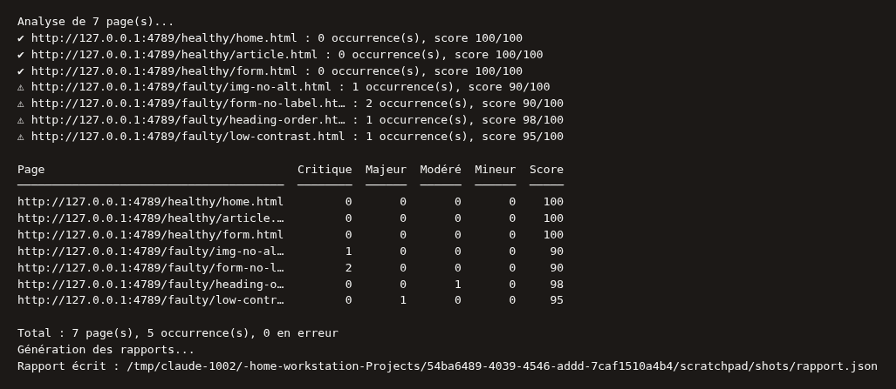
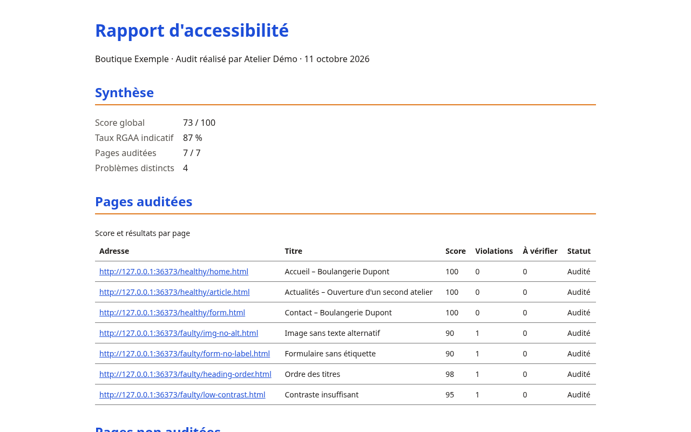

# a11y-report

Générateur de rapports d'accessibilité numérique en ligne de commande, pour agences et indépendants. À partir d'une liste d'URLs (ou d'un site exploré), il audite chaque page avec axe-core (WCAG 2.0, 2.1 et 2.2, niveaux A et AA, bonnes pratiques), puis produit un livrable client en français, à la marque de votre agence : constats expliqués, référence RGAA par règle, score, estimation partielle RGAA et devis de correction par étape.

Tout s'exécute en local (Playwright et axe-core embarqués) : aucune donnée n'est envoyée à un tiers.


## Installation

Prérequis : Node.js 22 ou plus, git.

```bash
git clone <url-du-dépôt> a11y-reports
cd a11y-reports
npm ci
npx playwright install chromium
```

Comptez de 2 à 5 minutes selon la connexion : `npm ci` télécharge les dépendances et les polices, puis `playwright install` télécharge Chromium (environ 150 Mo). Sous Linux, si Chromium signale des bibliothèques système manquantes, utilisez `npx playwright install --with-deps chromium`.

## Premier rapport en 3 commandes

Les pages de démonstration du dépôt (`test/fixtures`) servent de cible : aucun site réel n'est nécessaire. Ouvrez deux terminaux dans le dossier du dépôt.

```bash
# Terminal 1 : sert les pages de démonstration sur http://127.0.0.1:8081
npm run demo:serve

# Terminal 2 : audite deux pages et écrit rapport.pdf
node src/cli.js http://127.0.0.1:8081/faulty/img-no-alt.html http://127.0.0.1:8081/healthy/home.html \
  --client "Boutique Exemple" --agency "Atelier Démo" --color "#1d4ed8"

# Terminal 2 : ouvre le rapport (Linux : xdg-open, macOS : open)
xdg-open rapport.pdf
```

Une fois le navigateur installé, le premier rapport est prêt en moins d'une minute (quelques secondes par page). Un exemple déjà généré est disponible dans `site/assets/exemple-rapport.pdf` et `site/assets/exemple-rapport.html` ; `npm run build:demo` le régénère.



## Utilisation

```bash
node src/cli.js https://exemple.fr https://exemple.fr/contact \
  --client "Exemple SAS" \
  --agency "Mon Agence" \
  --color "#1d4ed8" \
  --contact "contact@agence.fr" \
  --out rapport-exemple.pdf
```

La progression s'affiche sur la sortie d'erreur ; le rapport est écrit à l'emplacement de `--out`.

## Options

Reprise de `node src/cli.js --help`.

| Option | Description |
| --- | --- |
| `<url...>` | Une ou plusieurs URLs `http://` ou `https://` à auditer. |
| `--client "X"` | Nom du client (requis, sauf via `--branding`). |
| `--agency "Y"` | Nom de l'agence (requis, sauf via `--branding`). |
| `--logo f.png` | Logo de l'agence affiché dans le rapport. |
| `--color #rrggbb` | Couleur principale du rapport. |
| `--contact "..."` | Coordonnées affichées dans le rapport. |
| `--taux 550` | Taux journalier moyen (TJM) en euros HT pour chiffrer le devis (défaut : 550). |
| `--telephone "..."` | Téléphone affiché dans le devis. |
| `--validite 30` | Validité du devis en jours (défaut : 30). |
| `--branding b.json` | Charge le branding depuis un fichier JSON. Les options passées en ligne de commande l'emportent. |
| `--format LISTE` | Formats générés : `pdf` (défaut), `json`, `html`, `csv`, `sarif`. Répétable ou séparés par des virgules. |
| `--out CHEMIN` | Fichier de sortie (un seul format) ou dossier (plusieurs formats, ou chemin se terminant par `/`). Défaut : `rapport.<format>`. |
| `--from-json scan.json` | Recharge un scan sauvegardé au lieu de lancer un audit (aucune URL requise). |
| `--save-json scan.json` | Sauvegarde le résultat de l'audit, pour le réutiliser avec `--from-json`. |
| `--concurrency N` | Pages auditées en parallèle, de 1 à 16 (défaut : 1). |
| `--viewport V` | `mobile`, `tablet`, `desktop` ou `LARGEURxHAUTEUR` (ex. `375x812`). Répétable (défaut : `desktop`). |
| `--crawl` | Explore le site à partir de chaque URL donnée (même origine, robots.txt respecté). |
| `--crawl-depth N` | Profondeur maximale des liens suivis, de 0 à 10 (défaut : 2). Requiert `--crawl`. |
| `--max-pages N` | Nombre maximal de pages découvertes, de 1 à 1000 (défaut : 50). Requiert `--crawl`. |
| `--sitemap` / `--no-sitemap` | Lit (défaut) ou ignore le `sitemap.xml`. Requiert `--crawl`. |
| `--exclude MOTIF` | Exclut les URLs correspondant au motif glob ; répétable. Requiert `--crawl`. |
| `--delay MS` | Pause entre deux requêtes d'exploration (défaut : 250 ms). Requiert `--crawl`. |
| `--ci` | Mode non interactif : sortie réduite, code de retour selon les seuils. |
| `--seuil "critical=0,serious=0"` | Seuils : `critical`, `serious`, `moderate`, `minor` (occurrences), `score` (minimal), `unaudited` (`true`/`false`). Requiert `--ci`. |
| `--seuils-fichier s.json` | Seuils lus dans un fichier JSON ; `--seuil` l'emporte. Requiert `--ci`. |
| `--ci-format github\|text` | Format des résultats de seuils (défaut : `text`). Requiert `--ci`. |
| `--no-color` | Désactive les couleurs du terminal (`NO_COLOR=1` a le même effet). |
| `-h, --help` | Affiche l'aide. |

## Formats de sortie

| Format | Usage |
| --- | --- |
| `pdf` | Livrable client A4, balisé (voir « Vérification PDF »). |
| `html` | Rapport autonome, consultable dans un navigateur. |
| `json` | Scan complet, rechargeable avec `--from-json`. |
| `csv` | Un tableau de constats pour un tableur. |
| `sarif` | Pour GitHub code scanning et les outils compatibles SARIF. |

```bash
node src/cli.js https://exemple.fr --format json,html --out ./rapports --client "Exemple SAS" --agency "Mon Agence"
```



## Explorer un site

```bash
node src/cli.js https://exemple.fr/ --crawl --crawl-depth 1 --max-pages 30 --concurrency 4 \
  --viewport mobile --viewport desktop --exclude "**/panier/**" --format html --out ./rapports \
  --client "Exemple SAS" --agency "Mon Agence"
```

L'exploration reste sur l'origine de l'URL donnée, lit le `sitemap.xml` et respecte `robots.txt`. Ajustez `--delay` pour ménager le serveur audité.

## Intégration continue

```bash
node src/cli.js https://preprod.exemple.fr/ --ci --seuil "critical=0,serious=0,score=80" --ci-format github \
  --format json --client "Exemple SAS" --agency "Mon Agence"
```

| Code | Signification |
| --- | --- |
| `0` | Succès (ou seuils respectés avec `--ci`). |
| `1` | Erreur d'usage ou d'exécution (URL invalide, option inconnue, fichier illisible, aucune URL). |
| `2` | Seuils CI non respectés. |
| `3` | Page non auditée alors que `unaudited=true`. |

Toute erreur affiche un message `Erreur : ...`. Modèles GitHub Actions et GitLab CI : [docs/ci/](docs/ci/). Détails des seuils : [docs/ci.md](docs/ci.md).

## Devis intégré

Le rapport se termine par un devis par étape (bloquants, gênants, finitions) : durée estimée, prix HT, TVA et total TTC. Le prix d'une étape est `heures × TJM × (1 + marge)`, avec un minimum par étape.

```bash
node src/cli.js https://exemple.fr --client "Exemple SAS" --agency "Mon Agence" \
  --taux 600 --telephone "01 23 45 67 89" --validite 30
```

Valeurs par défaut : TJM 550 € HT, marge 15 %, TVA 20 %, minimum par étape égal au TJM.

## Format de `branding.json`

```json
{
  "agency": "Mon Agence",
  "client": "Exemple SAS",
  "logoPath": "logo.png",
  "primaryColor": "#1d4ed8",
  "accentColor": "#f59e0b",
  "contact": "contact@agence.fr",
  "date": "2026-10-11",
  "phone": "01 23 45 67 89",
  "quoteValidityDays": 30,
  "tjm": 600,
  "marge": 0.15,
  "tva": 0.2,
  "minimumPhase": 600
}
```

| Champ | Obligatoire | Description |
| --- | --- | --- |
| `agency` | oui | Nom de l'agence. Seule marque mentionnée dans le rapport. |
| `client` | oui | Nom du client audité. |
| `logoPath` | non | Chemin du logo de l'agence. |
| `primaryColor` | non | Couleur principale, `#rrggbb`. |
| `accentColor` | non | Couleur d'accent, `#rrggbb`. |
| `contact` | non | Coordonnées affichées dans le rapport. |
| `date` | non | Date affichée dans le rapport. |
| `phone` | non | Téléphone affiché dans le devis. |
| `quoteValidityDays` | non | Validité du devis en jours (défaut : 30). |
| `tjm` | non | Taux journalier en euros HT, strictement positif (défaut : 550). |
| `marge` | non | Marge appliquée, fraction de 0 inclus à 1 exclu (défaut : 0,15). |
| `tva` | non | Taux de TVA, fraction de 0 inclus à 1 exclu (défaut : 0,2). |
| `minimumPhase` | non | Montant minimal HT par étape (défaut : le TJM). |

Trois exemples prêts à l'emploi : `design/brandings/*.json`. Les options `--taux`, `--color`, etc. l'emportent sur le fichier.

## Limites de l'audit automatique

- Un audit automatique détecte environ un tiers des problèmes d'accessibilité : il ne remplace pas un test manuel avec des lecteurs d'écran et un contrôle au clavier.
- Les contenus accessibles uniquement après connexion, interaction ou saisie ne sont pas audités, sauf si l'URL les atteint directement.
- Une page injoignable apparaît dans le rapport avec son erreur, sans interrompre l'audit des autres pages.
- Les points marqués « incomplet » par axe-core demandent une vérification humaine.
- Le rapport couvre les règles axe-core ; il n'est pas une certification de conformité RGAA ou WCAG.
- Estimation partielle RGAA : le rapport affiche une estimation calculée uniquement sur les critères RGAA vérifiables automatiquement. Ce n'est pas un taux de conformité RGAA : seul un audit humain peut l'établir.

## Vérification PDF

`npm run verify:pdf -- rapport.pdf` lance veraPDF (profil PDF/UA-1) via docker (`verapdf/cli`). La sortie est non nulle si le PDF n'est pas conforme. Le PDF produit est balisé, en langue `fr`, avec signets, et passe veraPDF sans règle en échec sur les rapports de contrôle. Détails et limites : [docs/pdf-accessibility.md](docs/pdf-accessibility.md).

## Développement

```bash
npm test                 # tests
npm run test:coverage    # tests avec seuil de couverture à 85 %
npm run build:demo       # régénère le rapport d'exemple du site
npm run check:dod        # preuves de la définition de terminé (out/dod.json)
npm run demo:serve       # sert les pages de démonstration sur le port 8081
```

Les tests de rendu et d'audit lancent Chromium : `npx playwright install chromium` est nécessaire avant `npm test`.

## Documentation

- [CONTRACT.md](CONTRACT.md) : contrat entre modules.
- [docs/ci.md](docs/ci.md) : intégration continue, seuils et codes de sortie.
- [docs/score.md](docs/score.md) : calcul du score.
- [docs/pdf-accessibility.md](docs/pdf-accessibility.md) : accessibilité du PDF.
- [docs/design.md](docs/design.md) : jetons et identité visuelle.
- [docs/decisions.md](docs/decisions.md) : décisions techniques.
- [docs/marche.md](docs/marche.md) et [docs/backlog.md](docs/backlog.md) : marché et feuille de route.
- [CHANGELOG.md](CHANGELOG.md) : historique des versions.

## Licence

Logiciel propriétaire, voir [LICENSE](LICENSE).
